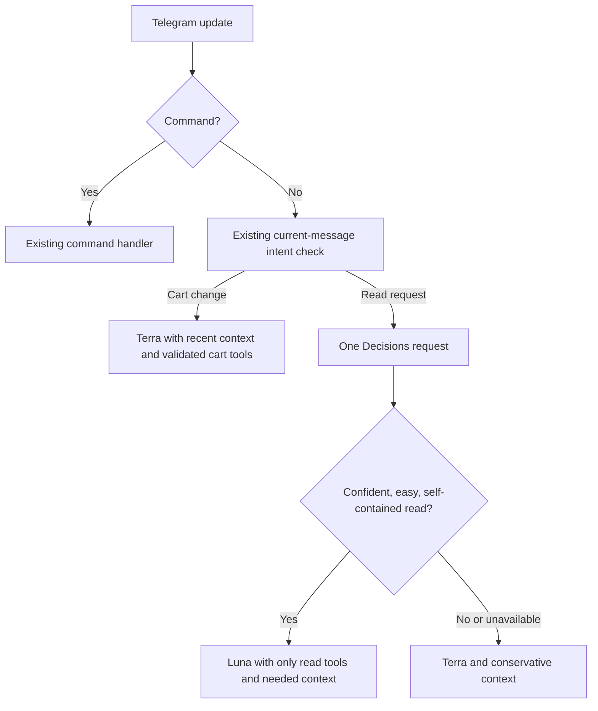

# Experimental Decisions routing

This is an opt-in experiment, separate from the running cart/search increment.
`OPENAI_DECISIONS_ROUTING=false` is the default. The initial live sample did not
establish an overall cost or latency improvement, so the working bot keeps its
existing path while the routing policy is evaluated.

OpenAI's Decisions API returns typed predicates, choices, and scores using
`gpt-6-luna`; it does not extract arbitrary tool arguments or execute functions.
The existing Responses function loop still resolves products and calls the
validated server functions. [API guide](https://developers.openai.com/api/docs/guides/decisions)

## Small decision chain



With routing disabled, the existing lazy intent check and Responses path are
preserved. With it enabled, that same intent check runs first. A detected cart
change skips Decisions entirely: it already needs Terra and careful state
handling. Decisions never grants cart permissions, authorizes payments, resolves
product IDs, or bypasses receipts, stock checks, or chat isolation.
If it identifies a cart change that the intent check did not authorize, the bot
returns the existing cart-rejected response without generating a success claim.
The accompanying dispatch tightening also prevents removal-only intent from
authorizing a positive quantity update, with routing enabled or disabled.

Three independent questions share the current message:

- **History:** Does understanding this refer to earlier chat messages? Keep the
  recent context unless the answer confidently says it is unnecessary. Database
  cart state is separate from conversation history.
- **Task:** Categories, catalog, cart view, cart change, comparison, or other.
  Code turns a sufficiently confident result into a tool hint, not an executable
  function call. Read tools remain available when a hint is wrong.
- **Difficulty:** Score the task against the rubric below. A short follow-up can
  need context without requiring complex reasoning.

| Level | Example |
| --- | --- |
| Easy | “Find notebooks” or “Show my cart” |
| Medium / average | “Compare these two notebooks” or “Find one under $10” |
| Difficult | “Choose stationery for five people within this budget, considering quality and size” |
| Very difficult | “Plan mixed supplies for several classrooms with different needs, stock limits, quantities, and a shared budget” |

“Average” and “medium” are one level to avoid overlapping labels. The API returns
an expected ordinal score from 0 to 3, not a measure of objective difficulty.

The initial operating points are deliberately conservative: history probability
at most 0.15 to omit context; task confidence at least 0.8; difficulty confidence
at least 0.8 and expected difficulty at most 0.25 for the fast read path. These
are provisional thresholds, not calibrated guarantees. `OPENAI_FAST_MODEL`
defaults to Luna; `OPENAI_MODEL` remains Terra. API errors, malformed/refused
answers, and missing fields fall back to the existing assistant behavior. The
Decisions request has a six-second timeout and no automatic retries.

## Evidence and next gate

The November 7, 2026 local smoke evaluation produced 11 responses from 12 attempted
requests; the last request hit a rate limit. Responses used 607–619 input tokens
and took 0.215–1.612 seconds. Required history was retained in both tested
follow-ups, but many independent queries unnecessarily retained history. Only
one sample qualified for the conservative fast read path. These examples are
small and synthetic; they do not establish production accuracy or savings.

At the documented Decisions rate of $0.10 per million uncached input tokens and
no output-token charge, a 610-token routing request is about $0.000061 before
other processing/cache charges. This is added overhead unless it avoids enough
main-model input, work, or an expensive request. [Decisions pricing](https://developers.openai.com/api/docs/guides/decisions#pricing-and-availability)

Run a repeatable, read-only live evaluation from the repository root:

```sh
python -m scripts.evaluate_decision_routing --limit 14 --output routing-evaluation.json
```

It uses fixed shopping examples, makes no tool calls or cart changes, and stops
on rate limiting. It requires the existing OpenAI key and incurs API usage.
Compare the candidate with the no-router baseline on representative multilingual
conversations before enabling it. Track task errors, lost context, wrong cart
outcomes, total input/output tokens, and end-to-end p50/p95 latency. Lower routing
thresholds only when those comparisons support the tradeoff.

## Inspiration, without another service

TypeSafe/Jev's useful patterns are small judgments composed in ordinary code:
[screen before an expensive stage](https://docs.typesafe.ai/patterns/noul-screen),
and [batch independent questions over the same input](https://docs.typesafe.ai/patterns/fan-out).
This implementation borrows those patterns using the existing OpenAI connection.
It adds no Jev dependency or account. Confidence guides fallback; it is not a
substitute for application validation.
